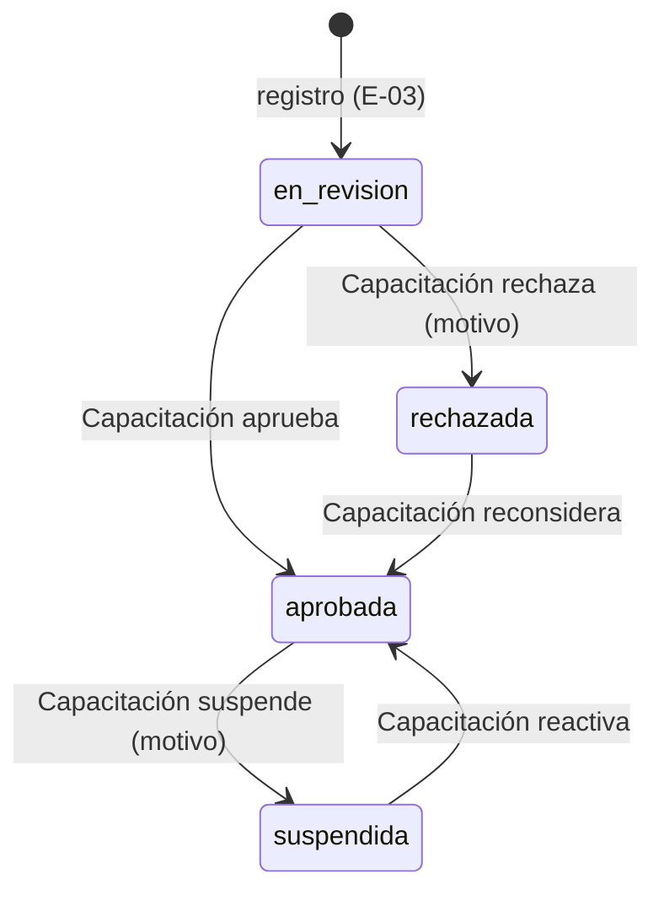
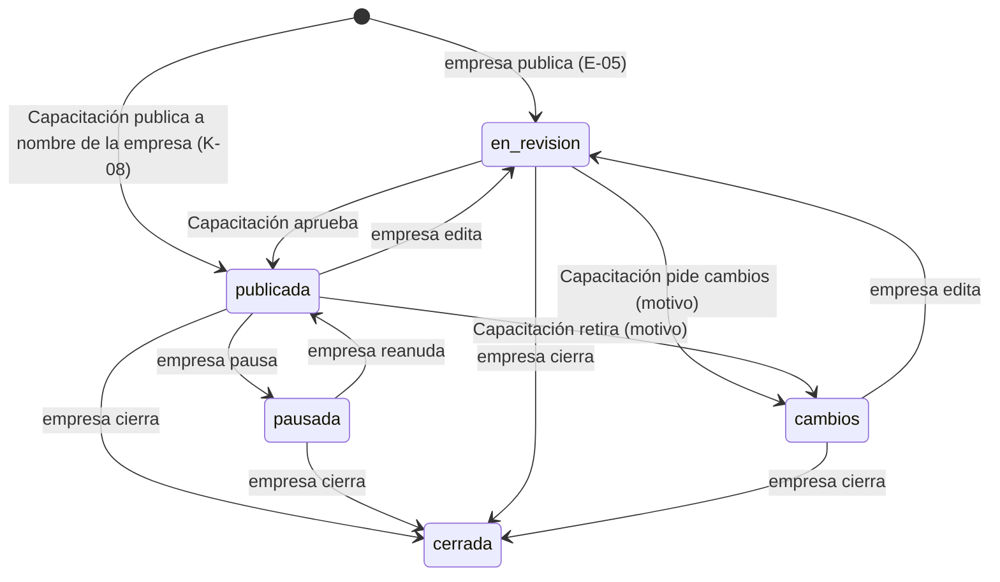
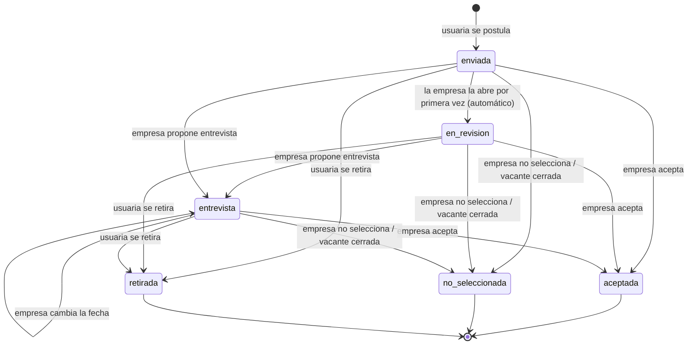
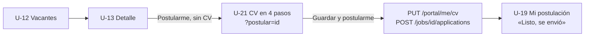
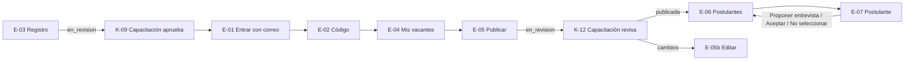
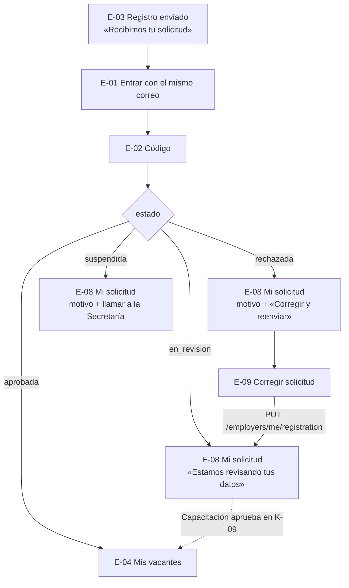
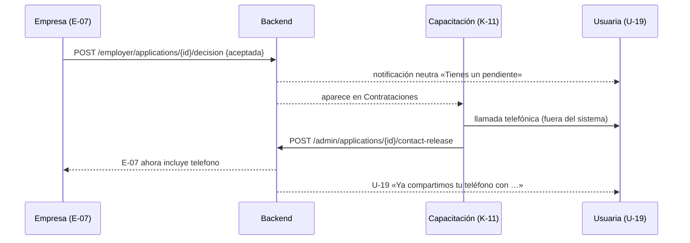

# SAI · Flujo de la bolsa de trabajo (para backend)

**Versión:** 0.1 · 26 de noviembre de 2026
**Complementa:** `FLUJO_PANTALLAS_SAI.md` y `ENDPOINTS_REQUERIDOS_SAI.md` (esta sección reemplaza la de «Bolsa de trabajo» de ese archivo).
**Código del frontend:** `src/features/bolsa/` (`api.ts` tiene cada endpoint con un comentario que nombra la ruta; hoy responden datos simulados).

Todas las rutas van bajo `/api/v1`. Son una propuesta del frontend: el backend decide la ruta definitiva y la publica en `contract/openapi.yaml`.

---

## 1. Decisiones de diseño

| # | Decisión | Consecuencia para el backend |
|---|---|---|
| D1 | **Las empresas tienen su propio portal** (`/e`). Capacitación aprueba a cada empresa y revisa cada vacante antes de publicarla. | Nuevo tipo de cuenta `employer`, separada de personal (`/auth`) y de usuarias (`/portal`). |
| D2 | **La empresa ve el CV sin contacto.** Ve nombre de pila, estudios, experiencia, habilidades y disponibilidad. Nunca ve apellidos, teléfono, CURP, dirección ni nada del expediente. | El serializador de empresa es una lista blanca. El teléfono solo se incluye cuando Capacitación lo entrega (D2b). |
| D2b | **El contacto lo entrega la Secretaría**, después de que la empresa acepta y de que Capacitación habla con la usuaria. | Hay un endpoint explícito de entrega, con bitácora. |
| D3 | **El CV se arma en 4 pasos con opciones.** El nombre y el teléfono se toman de la cuenta de la usuaria. «Sin experiencia» es válido. | Un CV por usuaria (`PUT` idempotente). Cada postulación guarda una **copia congelada** del CV de ese momento. |
| D4 | **Estados de la postulación:** Enviada → En revisión → Entrevista → Aceptada / No seleccionada, y Retirada (la usuaria). La empresa propone la entrevista y la usuaria confirma con un toque. | Máquina de estados de la sección 4, validada en el servidor. |

Principio general: **pedir lo mínimo y nunca exponer a la usuaria.** El portal de usuarias tiene salida rápida y página neutra; la bolsa no puede ser la vía por la que un agresor la localice.

---

## 2. Actores y permisos

| Actor | Sesión | Puede | No puede |
|---|---|---|---|
| **Usuaria** | `/portal/auth/*` (código por SMS) | Ver vacantes **publicadas**, armar su CV, postularse, ver sus postulaciones, responder entrevistas, retirarse | Ver postulaciones ajenas o datos de la empresa más allá de la vacante |
| **Empresa** | `/employers/auth/*` (código por correo, sin contraseña) | Registrarse, publicar y editar **sus** vacantes, ver **sus** postulantes, proponer entrevista, aceptar o no seleccionar | Ver el contacto antes de que Capacitación lo entregue; ver postulaciones retiradas; ver vacantes de otras empresas |
| **Capacitación** | `/auth/*` (personal con 2FA), rol `capacitacion` | Aprobar, rechazar o suspender empresas; aprobar o pedir cambios en vacantes; publicar a nombre de una empresa; ver todas las postulaciones en conteos; entregar contacto | Ver el expediente de la usuaria desde la bolsa (sigue las reglas normales de expedientes) |

Reglas:
- Toda consulta de empresa se filtra por `employerId` de la sesión. Un recurso de otra empresa responde **404** (no 403), igual que en expedientes.
- Una empresa con estado distinto de `aprobada` **sí puede iniciar sesión, pero con una sesión limitada** (`scope: "registration"`): solo puede llamar a `GET /employers/me/registration`, `PUT /employers/me/registration` y `POST /employers/auth/logout`. Cualquier otra ruta de `/employer/*` responde **403** `code: "employer_not_approved"`. Así la empresa puede consultar su solicitud y corregirla sin un canal aparte (ver §5.3.1).

---

## 3. Modelo de datos

### Employer (empresa)

| Campo | Tipo | Reglas |
|---|---|---|
| `id` | uuid | |
| `nombre` | texto ≤ 100 | Obligatorio |
| `rfc` | texto 12–13 | Obligatorio, único, `^[A-ZÑ&]{3,4}\d{6}[A-Z0-9]{3}$`, en mayúsculas |
| `sector` | catálogo | `Servicios, Comercio, Agroindustria, Salud, Educación` |
| `contacto` | texto ≤ 80 | Persona de contacto |
| `correo` | email | Obligatorio, único; es el usuario para entrar |
| `telefono` | 10 dígitos | Obligatorio |
| `estado` | enum | `en_revision` (inicial), `aprobada`, `rechazada`, `suspendida` |
| `motivo` | texto | Obligatorio al rechazar o suspender |
| `solicitada`, `revisadaPor`, `revisadaEn` | | Auditoría |

### Job (vacante)

| Campo | Tipo | Reglas |
|---|---|---|
| `id`, `employerId` | uuid | |
| `puesto` | texto ≤ 80 | Obligatorio |
| `sector`, `horario`, `tipoEmpleo`, `ubicacion` | catálogos | `horario`: Matutino, Vespertino, Mixto. `tipoEmpleo`: Tiempo completo, Medio tiempo, Temporal. `ubicacion`: Los Mochis, Higuera de Zaragoza, Topolobampo, Ahome |
| `sueldo` | texto ≤ 40 | Opcional (texto libre: «$8,000 al mes») |
| `descripcion` | texto ≤ 600 | Obligatorio |
| `requisitos` | texto[] | Opcional, máximo 10 de ≤ 120 |
| `estado` | enum | `en_revision`, `cambios`, `publicada`, `pausada`, `cerrada` |
| `motivoCambios` | texto | Lo que pidió Capacitación (con `cambios`) |
| `actualizada` | fecha | |

### Cv (uno por usuaria)

| Campo | Tipo | Reglas |
|---|---|---|
| `userId` | uuid | Clave |
| `escolaridad` | enum | `Sin estudios, Primaria, Secundaria, Preparatoria, Carrera técnica, Licenciatura` |
| `experiencia` | `{puesto ≤ 60, tiempo}[]` | 0 a 3 elementos. Vacío = primer empleo. `tiempo`: Menos de 1 año, 1 a 3 años, Más de 3 años |
| `habilidades` | texto[] | 1 a 15. Catálogo (sección 3.1) más una opción libre ≤ 40 |
| `horarios` | texto[] | 1 a 3, del catálogo de `horario` |
| `inicio` | enum | De inmediato, En 2 semanas, En 1 mes |
| `sobreMi` | texto ≤ 140 | Opcional |
| `actualizado` | fecha | |

El nombre que ve la empresa es el **nombre de pila** de la cuenta de la usuaria (primer nombre), calculado por el servidor. No se guarda en el CV.

#### 3.1 Catálogo de habilidades

Atención a clientes, Limpieza, Cocina, Ventas, Caja y cobro, Computadora básica, Cuidado de personas, Costura, Campo y empaque, Manejo de redes sociales, Organización y archivo, Trabajo en equipo. Conviene servirlo desde `GET /catalogs` (clave `jobSkills`) junto con los demás catálogos de esta sección.

### Application (postulación)

| Campo | Tipo | Reglas |
|---|---|---|
| `id` | uuid | |
| `folio` | texto | `BT-0001`, secuencial, para hablar de la postulación por teléfono sin nombres |
| `jobId`, `userId` | uuid | Único por par (`409` si se repite, salvo que la anterior esté `retirada`) |
| `cvSnapshot` | json | Copia del CV al postularse. Editar el CV después **no** cambia postulaciones ya enviadas |
| `estado` | enum | Sección 4 |
| `historial` | `{estado, fecha, actor}[]` | Se agrega una fila por transición |
| `vista` | bool | `true` desde la primera vez que la empresa abre la postulación |
| `entrevista` | `{fecha, hora, modalidad, lugar, respuesta}` | `modalidad`: Presencial, Llamada, Videollamada. `respuesta`: `null`, `confirmada`, `otra_fecha` |
| `motivoNo` | catálogo | Solo con `no_seleccionada`. **Lo ve Capacitación, nunca la usuaria** |
| `contactoEntregado`, `contactoEntregadoPor`, `contactoEntregadoEn` | | Sección 6 |

---

## 4. Máquinas de estado

### 4.1 Empresa



Al **suspender**: todas sus vacantes `publicada` pasan a `pausada` y sus sesiones activas se revocan.

### 4.2 Vacante



- Solo `publicada` aparece en `GET /jobs` y `GET /jobs/{id}` (para la usuaria). Cualquier otro estado responde 404 a la usuaria.
- Mientras la vacante está en `en_revision` o `cambios` después de una edición, **las postulaciones existentes se conservan** y la empresa puede seguir gestionándolas; solo se bloquean postulaciones nuevas.
- **Cerrar** es definitivo. Las postulaciones en `enviada`, `en_revision` o `entrevista` pasan a `no_seleccionada` con `motivoNo = "La vacante se cubrió"` y se avisa a cada usuaria.
- Sugerencia: cerrar automáticamente las vacantes `publicada` sin cambios en 60 días.

### 4.3 Postulación



| Transición | Actor | Endpoint | Validaciones | Efectos |
|---|---|---|---|---|
| → `enviada` | Usuaria | `POST /jobs/{id}/applications` | Vacante `publicada`; la usuaria tiene CV (si no: **422** `code: "cv_required"`); sin postulación activa a la misma vacante (**409**) | Copia el CV en `cvSnapshot`. Suma a «nuevas» de la empresa |
| `enviada` → `en_revision` | Sistema | `GET /employer/applications/{id}` | Primera lectura de la empresa | `vista = true`. Es la única lectura con efecto; debe ser idempotente |
| → `entrevista` | Empresa | `POST /employer/applications/{id}/interview` | Estado no final; `fecha` ≥ hoy; `lugar` obligatorio | Si ya existía, la reemplaza y `respuesta` vuelve a `null`. Notifica a la usuaria |
| Respuesta a entrevista | Usuaria | `POST /portal/me/applications/{id}/interview-response` | Estado `entrevista`; `respuesta` ∈ `confirmada`, `otra_fecha` | No cambia el estado. Si `otra_fecha`, avisa a la empresa para que proponga otra |
| → `aceptada` | Empresa | `POST /employer/applications/{id}/decision` `{decision:"aceptada"}` | Estado no final | Notifica a la usuaria y agrega la postulación a «Contrataciones» de Capacitación (K-11) |
| → `no_seleccionada` | Empresa | `POST /employer/applications/{id}/decision` `{decision:"no_seleccionada", motivo}` | Estado no final; `motivo` del catálogo | Notificación amable a la usuaria, **sin motivo** |
| → `retirada` | Usuaria | `POST /portal/me/applications/{id}/withdrawal` | Estado no final | Desaparece de la lista de la empresa (sus endpoints responden 404). La usuaria puede volver a postularse |

Cualquier transición no listada responde **409** `code: "invalid_transition"`. Los estados finales son `aceptada`, `no_seleccionada` y `retirada`.

---

## 5. Flujos paso a paso

### 5.1 Usuaria: postularse por primera vez (sin CV)



1. **U-12** `GET /jobs` con filtros opcionales. La usuaria toca una vacante.
2. **U-13** `GET /jobs/{id}` y `GET /portal/me/cv`. Si el CV es `null`, el botón «Postularme» lleva al asistente de CV.
3. **U-21** cuatro pantallas con opciones: estudios → ¿has trabajado? (sí con hasta 3 trabajos, o «aún no») → habilidades (chips) → horarios y cuándo empieza. Al final llama `PUT /portal/me/cv` y luego `POST /jobs/{id}/applications`.
4. **U-19** muestra el avance.

Con CV ya guardado: en U-13, «Postularme» muestra una confirmación en la misma pantalla («Tu teléfono y tu dirección no se comparten») y un solo botón: «Enviar mi postulación».

**Datos que escribe la usuaria:** cero campos obligatorios de texto libre si nunca ha trabajado; uno por trabajo si sí.

### 5.2 Usuaria: seguir sus postulaciones

- **U-18** `GET /portal/me/applications`: activas primero. Si hay una entrevista con `respuesta = null`, la tarjeta lo resalta y el inicio (U-05) muestra una insignia en «Bolsa de trabajo».
- **U-19** `GET /portal/me/applications/{id}`: avance en 4 pasos y un mensaje por estado. En `entrevista` hay dos botones: «Sí, ahí estaré» y «No puedo, pedir otra fecha». Si la postulación no es final, puede retirarse (con confirmación).
- **U-20 / U-21** ver y editar el CV.

### 5.3 Empresa



1. **E-03** `POST /employers/registrations` → `201 {id, estado:"en_revision"}`. 409 si el RFC o el correo ya existen. La pantalla promete respuesta en 3 días hábiles.
2. **E-01/E-02** `POST /employers/auth/login {correo}` → `202 {challengeId, correoMascara}`; `POST /employers/auth/verify {challengeId, code}` → `200 {id, nombre, estado}` y cookie HttpOnly. Si `estado = aprobada` va a E-04; si no, a **E-08 Mi solicitud** (§5.3.1). Mismas reglas de bloqueo y `429` que en el portal de usuarias. Responder 202 aunque el correo no exista (no revelar qué empresas están registradas).
3. **E-04** `GET /employer/jobs` con `postulaciones` (sin retiradas) y `nuevas` (`vista = false`).
4. **E-05** `POST /employer/jobs` → nace `en_revision`. **E-05b** `PATCH /employer/jobs/{id}` con datos → vuelve a `en_revision`. El mismo `PATCH` con solo `{estado}` pausa, reanuda o cierra.
5. **E-06** `GET /employer/jobs/{id}` y `GET /employer/jobs/{id}/applications`. El filtro por estado se hace en el cliente (o con `?status=`).
6. **E-07** `GET /employer/applications/{id}` → postulante con `cvSnapshot` como `cv` y `telefono` solo si `contactoEntregado`. Desde aquí: entrevista, aceptar o no seleccionar.

#### 5.3.1 Después de enviar la solicitud (E-03 → E-08 → E-09)



1. **E-03** termina con «Recibimos tu solicitud» y la indicación de que puede consultar el avance entrando con el mismo correo.
2. **E-08 Mi solicitud** (`/e/solicitud`) llama a `GET /employers/me/registration` y muestra el avance en 3 pasos (Solicitud enviada → Revisión de Capacitación → Lista para publicar) y un mensaje por estado:
   - `en_revision`: «Estamos revisando tus datos», a quién pueden llamar y en cuánto tiempo.
   - `rechazada`: el **motivo** que escribió Capacitación y el botón «Corregir y reenviar».
   - `suspendida`: el motivo y que debe comunicarse con la Secretaría. No hay autocorrección.
   - `aprobada` (si la aprueban mientras tiene la sesión abierta): botón «Ir a mis vacantes». El frontend vuelve a pedir la sesión con el estado nuevo; el backend debe **ampliar la sesión limitada** en cuanto la empresa queda aprobada (o pedir que entre de nuevo y responder 401).
3. **E-09 Corregir solicitud** (`/e/solicitud/corregir`) muestra lo que pidió Capacitación y el formulario con los datos actuales. El **correo no se edita** porque es la identidad de acceso; para cambiarlo, la empresa llama a la Secretaría. `PUT /employers/me/registration` pone `estado = en_revision`, borra `motivo`, actualiza `solicitada` y la empresa vuelve a aparecer en K-09.
4. Mientras la empresa no esté aprobada, la barra de `/e` no muestra «Mis vacantes» ni «Publicar», y cualquier ruta de gestión redirige a E-08.

Reglas para el backend:
- Guardar el historial de la solicitud (`enviada`, `rechazada` con motivo, `reenviada`, `aprobada`) para que Capacitación vea cuántas veces se corrigió.
- Limitar los reenvíos (sugerencia: 3). Después, `409 code: "too_many_resubmissions"` y la pantalla pide llamar a la Secretaría.
- Avisar por correo a la empresa en cada cambio de estado (§8).

### 5.4 Capacitación

| Pantalla | Ruta | Endpoints |
|---|---|---|
| **K-07** Vacantes (todas) | `/capacitacion/bolsa` | `GET /admin/jobs` |
| **K-08** Nueva vacante a nombre de una empresa | `/capacitacion/bolsa/nueva` | `GET /admin/employers?status=aprobada`, `POST /admin/jobs` (nace `publicada`) |
| **K-09** Por revisar | `/capacitacion/bolsa/revisar` | `GET /admin/jobs?status=en_revision`, `GET /admin/employers?status=en_revision`, `POST /admin/employers/{id}/review` |
| **K-10** Empresas | `/capacitacion/bolsa/empresas` | `GET /admin/employers`, `POST /admin/employers/{id}/review` |
| **K-11** Contrataciones | `/capacitacion/bolsa/contrataciones` | `GET /admin/hires`, `POST /admin/applications/{id}/contact-release` |
| **K-12** Revisar vacante | `/capacitacion/bolsa/vacantes/:id` | `GET /admin/jobs/{id}` (con `porEstado`), `POST /admin/jobs/{id}/review` |

Al revisar una vacante, la pantalla recuerda que no debe pedir datos discriminatorios (estado civil, embarazo, fotografía, edad sin justificación).

---

## 6. Entrega de contacto (aceptada → teléfono a la empresa)



- Capacitación solo entrega el contacto si la usuaria lo confirma por teléfono. Si ella ya no quiere el empleo, Capacitación lo marca como `retirada` en su nombre (`POST /admin/applications/{id}/withdrawal`, pendiente de pantalla) y no entrega nada.
- La entrega queda en la bitácora (`actor`, `fecha`, `applicationId`) y no se puede deshacer.
- Antes de entregar, el backend debe revisar si el expediente de la usuaria tiene **alerta de riesgo** o una indicación de no compartir datos. Si es así, responde **409** `code: "contact_blocked"` y Capacitación lo canaliza con Trabajo social. La pantalla K-11 debe mostrar ese aviso (pendiente en el frontend).

---

## 7. Endpoints

`U` = usuaria, `E` = empresa, `K` = Capacitación. Todas las escrituras exigen CSRF; las de creación aceptan `Idempotency-Key`.

| Método y ruta | Actor | Cuerpo | Respuesta | Errores | Pantalla |
|---|---|---|---|---|---|
| `GET /jobs?sector&schedule&type&location` | U | | `200 Vacante[]` (solo `publicada`, con `postulada`) | | U-12 |
| `GET /jobs/{id}` | U | | `200 Vacante` | 404 si no está publicada | U-13 |
| `GET /portal/me/cv` | U | | `200 Cv` o `200 null` | | U-13, U-20, U-21 |
| `PUT /portal/me/cv` | U | `Cv` sin `actualizado` | `200 Cv` | 422 validación | U-21 |
| `POST /jobs/{id}/applications` | U | (vacío) | `201 Postulacion` | 404, 409 duplicada, 422 `cv_required` | U-13, U-21 |
| `GET /portal/me/applications` | U | | `200 Postulacion[]` | | U-18, U-05 |
| `GET /portal/me/applications/{id}` | U | | `200 Postulacion` | 404 | U-19 |
| `POST /portal/me/applications/{id}/interview-response` | U | `{respuesta}` | `204` | 409 | U-19 |
| `POST /portal/me/applications/{id}/withdrawal` | U | | `204` | 409 | U-19 |
| `POST /employers/registrations` | Público | `{nombre, rfc, sector, contacto, correo, telefono, aceptaAviso:true}` | `201 {id, estado}` | 409 RFC/correo, 422, 429 | E-03 |
| `POST /employers/auth/login` | Público | `{correo}` | `202 {challengeId, correoMascara}` | 429 | E-01 |
| `POST /employers/auth/verify` | Público | `{challengeId, code}` | `200 {id, nombre, estado}` + cookie (limitada si `estado ≠ aprobada`) | 401 | E-02 |
| `GET /employers/me/registration` | E (cualquier estado) | | `200 Empresa` con `estado`, `solicitada`, `motivo?` | | E-08, E-09 |
| `PUT /employers/me/registration` | E (solo `rechazada`) | `{nombre, rfc, sector, contacto, telefono}` | `200 {estado:"en_revision"}` | 409 si no está `rechazada`, 409 RFC duplicado, 422 | E-09 |
| `POST /employers/auth/logout` | E | | `204` | | Barra de E |
| `GET /employer/jobs` | E | | `200 Vacante[]` con `postulaciones`, `nuevas` | | E-04 |
| `POST /employer/jobs` | E | `DatosVacante` | `201 Vacante` (`en_revision`) | 422 | E-05 |
| `GET /employer/jobs/{id}` | E | | `200 Vacante` | 404 | E-05b, E-06 |
| `PATCH /employer/jobs/{id}` | E | `Partial<DatosVacante>` **o** `{estado: pausada\|publicada\|cerrada}` | `204` | 409 transición, 412 `If-Match` | E-05b, E-06 |
| `GET /employer/jobs/{id}/applications?status=` | E | | `200 Postulante[]` (sin retiradas) | 404 | E-06 |
| `GET /employer/applications/{id}` | E | | `200 Postulante` | 404 | E-07 |
| `POST /employer/applications/{id}/interview` | E | `{fecha, hora, modalidad, lugar}` | `204` | 409, 422 | E-07 |
| `POST /employer/applications/{id}/decision` | E | `{decision, motivo?}` | `204` | 409, 422 | E-07 |
| `GET /admin/jobs?status=` | K | | `200 Vacante[]` con conteos | | K-01, K-07, K-09 |
| `GET /admin/jobs/{id}` | K | | `200 Vacante & {porEstado}` | 404 | K-12 |
| `POST /admin/jobs` | K | `DatosVacante & {empresaId}` | `201 Vacante` (`publicada`) | 422, 409 empresa no aprobada | K-08 |
| `POST /admin/jobs/{id}/review` | K | `{aprobar, motivo?}` | `204` | 409, 422 sin motivo | K-12 |
| `GET /admin/employers?status=` | K | | `200 Empresa[]` | | K-08, K-09, K-10 |
| `POST /admin/employers/{id}/review` | K | `{estado: aprobada\|rechazada\|suspendida, motivo?}` | `204` | 409, 422 sin motivo | K-09, K-10 |
| `GET /admin/hires` | K | | `200 Contratacion[]` | | K-11 |
| `POST /admin/applications/{id}/contact-release` | K | | `204` | 409 no aceptada, 409 `contact_blocked` | K-11 |

Formas de respuesta (TypeScript, tal como las consume el frontend en `src/features/bolsa/api.ts`):

```ts
type Vacante = { id; empresaId; empresa; puesto; sector; horario; tipoEmpleo; ubicacion; sueldo?; descripcion; requisitos: string[];
  estado: 'en_revision'|'cambios'|'publicada'|'pausada'|'cerrada'; motivoCambios?; actualizada;
  postulada?: boolean /* U */; postulaciones?: number; nuevas?: number /* E, K */ }
type Postulacion = { id; folio; vacanteId; puesto; empresa; estado; enviada; historial: {estado, fecha}[];
  entrevista?: { fecha; hora; modalidad; lugar; respuesta: 'confirmada'|'otra_fecha'|null }; contactoEntregado?: boolean }
type Postulante = Postulacion & { cv: Cv & { nombre: string }; vista: boolean; telefono?: string /* solo si contactoEntregado */ }
type Contratacion = { postulacionId; folio; nombre; puesto; empresa; fecha; contactoEntregado: boolean }
```

---

## 8. Notificaciones

Todas las de la usuaria siguen la regla del portal: **texto neutro** («Tienes un pendiente»), sin nombre de la empresa ni del puesto en el aviso del teléfono. El detalle se ve al entrar.

| Evento | Usuaria | Empresa (correo) | Capacitación |
|---|---|---|---|
| Empresa registrada | | «Recibimos tu solicitud» | Aparece en K-09 |
| Empresa aprobada / rechazada / suspendida | | Correo con resultado, motivo y enlace a `/e` para ver su solicitud | |
| Empresa reenvía solicitud corregida | | «Recibimos tus correcciones» | Vuelve a K-09 |
| Vacante enviada a revisión | | | Aparece en K-09 |
| Vacante aprobada / con cambios | | Correo con resultado y motivo | |
| Nueva postulación | | Resumen diario (no uno por postulante) | |
| Entrevista propuesta o cambiada | Aviso neutro | | |
| Usuaria pide otra fecha | | Correo | |
| Aceptada | Aviso neutro | | Aparece en K-11 |
| No seleccionada / vacante cerrada | Aviso neutro | | |
| Contacto entregado | Aviso neutro | Correo: «Ya puedes ver el teléfono» | |
| Recordatorio de entrevista (un día antes) | Aviso neutro | | |

---

## 9. Privacidad, seguridad y bitácora

1. **Lista blanca para la empresa.** El serializador de `Postulante` solo incluye los campos de la sección 7. Nunca `userId`, apellidos, CURP, teléfono (salvo entregado), correo, dirección, ubicación, datos del expediente ni de alertas.
2. **Copia congelada.** La empresa ve el `cvSnapshot`, no el CV vivo: si la usuaria cambia algo después, la empresa no se entera.
3. **Retirada = invisible.** Una postulación retirada responde 404 a la empresa.
4. **Bitácora** (la misma de D-05) para: aprobar, rechazar o suspender empresas; revisar vacantes; cada decisión de la empresa; cada **entrega de contacto**; cada lectura de E-07 (quién de la empresa vio qué postulante).
5. **Límites.** `POST /jobs/{id}/applications`: 20 por usuaria al día. `POST /employers/registrations` y `/employers/auth/login`: por IP y por correo, con `429` y `Retry-After`.
6. **Retención.** Postulaciones finales se anonimizan 12 meses después (se conserva el conteo para reportes). Un CV se borra si la usuaria lo pide o si cierra su cuenta.
7. **Reportes (D-02).** Conteos agregados: vacantes publicadas, postulaciones por estado, contrataciones por sector, sin datos personales y con la supresión de celdas pequeñas que ya usa el tablero.

---

## 10. Pendiente o fuera de alcance

- Descargar el CV en PDF (útil para la usuaria; no se envía a la empresa).
- Pantalla de Capacitación para retirar una postulación a nombre de la usuaria y para ver el aviso `contact_blocked`.
- Varios usuarios por empresa (hoy: un correo por empresa).
- Perfil de empresa editable desde `/e` (hoy solo lo cambia Capacitación).
- Buscador de vacantes por texto.
