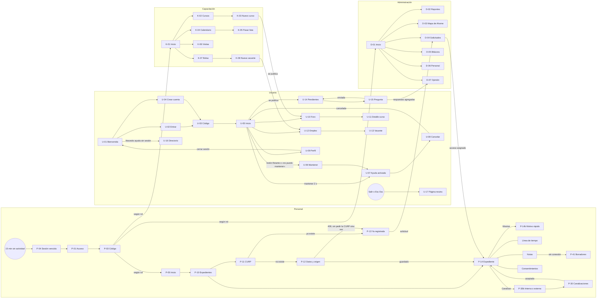

# SAI · Flujo de pantallas implementado (51 pantallas)

**Versión:** 1.0 · 26 de noviembre de 2026
**Base:** archivo de Figma «SAI · Pantallas y flujo (v1)», `planeacion.pdf`, `IDENTIDAD_SAI.pdf` y `FLUJO_PANTALLAS_SAI_MVP.md`.
**Complemento:** `ENDPOINTS_REQUERIDOS_SAI.md` (qué endpoint usa cada pantalla y cuáles faltan en `contract/openapi.yaml`).

Este documento describe **lo que ya está construido en el código**: qué ruta tiene cada pantalla, dónde vive su código y cómo se pasa de una a otra. Todas las pantallas funcionan con datos simulados mientras el backend publica los endpoints.

> Nota: durante la implementación, Figma cortó la conexión por el límite de llamadas del plan gratuito. Las pantallas se construyeron con la lista y el flujo del archivo `SAI_pantallas_y_flujo.md` y con el manual de identidad. Conviene revisarlas contra el Figma cuando haya acceso.

---

## 1. Cómo probarlo

```bash
npm run dev              # datos simulados (valor por defecto)
```

- **Portal de usuarias:** abre `/u`. En «Entrar» escribe cualquier CURP o nombre y cualquier código de 6 dígitos.
- **Personal:** abre `/acceso`. Escribe cualquier usuario y contraseña, elige el **rol de demostración** (solo aparece con datos simulados) y cualquier código de 6 dígitos.
- **Comprobar CURP (P-11):** una CURP válida que termine en `0` simula «ya registrada». Cualquier otra simula «no existe».

Para usar la API real: `VITE_DATOS_SIMULADOS=false npm run dev`. Con `make mock` en otra terminal y `make dev-mock` se usa el servidor simulado de Prism generado desde el contrato.

## 2. Arquitectura

```
src/
  app/               rutas, menú por rol (nav.ts), panel del personal (Layout.tsx), inicio por rol
  shared/lib/        servicio.ts (capa única de llamadas: simulado o API real), formato.ts
  shared/ui/         Encabezado, Estados (cargando, vacío, error), Diálogo, Pestañas, NoDisponible (P-90)
  features/
    identidad/       sesión en memoria, acceso del personal y de usuarias
    portal/          pantallas U-xx del portal (celular)
    ayuda/           directorio, botón de mantener 2 s, alerta de la usuaria, P-51, página neutra
    expedientes/     P-05, P-10 a P-17, P-41
    canalizacion/    P-30 y P-30b
    capacitacion/    K-01 a K-06 (y datos de cursos que usa el portal)
    bolsa/           bolsa de trabajo: U-12, U-13, U-18 a U-21, portal de empresas E-01 a E-07, K-07 a K-12
    encuestas/       datos de U-14, U-15 y D-07
    administracion/  D-01, D-02, D-04, D-06, D-07
    bitacora/        datos de D-05
    tablero/         D-03 Mapa de Ahome (el mapa existente, sin datos)
```

Cada carpeta de `features/` tiene un `api.ts` con **hooks de React Query** (`useExpedientes`, `useCursos`, …). Cada hook llama a `pedir()` de `shared/lib/servicio.ts` con el método, la ruta del endpoint y una respuesta simulada. Las pantallas no saben si los datos son simulados o reales: cuando el endpoint exista, basta con apagar los simulados; si la forma de la respuesta cambia, se ajusta solo el `api.ts`.

Reglas que se mantienen:

- La sesión vive **solo en memoria**. Al recargar se pide entrar de nuevo. No se usa `localStorage` ni `sessionStorage`.
- La CURP del alta vive en memoria mientras dura el trámite (P-11 a P-13) y se borra al salir. Nunca va en la URL ni en el historial.
- Un expediente ajeno y uno inexistente muestran la misma pantalla P-90. Una ruta de otro rol también.
- **Se oculta, no se pone candado:** el expediente muestra solo las áreas del actor y un aviso genérico igual para todos («Solo ves la información de las áreas en las que participas»).
- «Salir» está en todas las pantallas. En el portal lleva a la página neutra U-17 y en el panel a la página neutra configurada (`features/ayuda/config.ts`). Esc dos veces hace lo mismo.
- La sesión del personal se cierra tras 15 minutos sin actividad y lleva a P-04.

## 3. Panel del personal y menú

El panel usa el **diseño móvil de la rama `modificaciones_css`** (Leticia):

- **Celular:** barra superior fija con botón «Menú» que abre un cajón lateral, y una barra inferior con 3 accesos fijos.
- **Escritorio:** menú lateral ciruela que se puede ocultar y cambiar de ancho (arrastrando o con flechas del teclado).

Lo que cambia es que las opciones salen del **rol** (`MENU_POR_ROL` en `src/app/nav.ts`):

| Rol | Menú | Barra inferior en celular |
|---|---|---|
| Trabajo social | Inicio · Expedientes · Nuevo · Canalizaciones · Pendientes · Ayuda · Mi cuenta | Inicio · Expedientes · Ayuda |
| Psicología, Jurídico | Inicio · Expedientes · Canalizaciones · Pendientes · Ayuda · Mi cuenta | Inicio · Expedientes · Ayuda |
| Capacitación | Inicio · Cursos y charlas · Calendario · Visitas · Bolsa de trabajo · Ayuda · Mi cuenta | Inicio · Cursos y charlas · Ayuda |
| Administración | Inicio · Reportes · Mapa de calor · Solicitudes · Bitácora · Personal · Opinión · Ayuda · Mi cuenta | Inicio · Mapa de calor · Ayuda |

La barra superior muestra siempre el nombre y la **etiqueta de área** (colores del manual), el botón **Necesito ayuda** (P-51) y **Salir**.

El **portal de usuarias** tiene su propio marco, pensado para celular (máximo 30 rem de ancho): logotipo y Salir arriba, menú inferior de 4 opciones (Inicio, Foro, Empleo, Perfil) y el botón flotante de ayuda de 64 px en todas las pantallas menos Inicio, donde el botón grande ocupa todo el ancho.

## 4. Inventario de pantallas

### A · Portal de usuarias (celular, 360 px)

| ID | Pantalla | Ruta | Código |
|---|---|---|---|
| U-01 | Bienvenida | `/u` | `portal/AccesoUsuaria.tsx` |
| U-02 | Entrar (CURP o nombre completo) | `/u/entrar` | `portal/AccesoUsuaria.tsx` |
| U-03 | Código por mensaje | `/u/codigo` | `portal/AccesoUsuaria.tsx` |
| U-04 | Crear mi cuenta | `/u/crear-cuenta` | `portal/AccesoUsuaria.tsx` |
| U-05 | Inicio (botón grande de mantener 2 s) | `/u/inicio` | `portal/InicioUsuaria.tsx` |
| U-06 | Mantener 2 segundos (con confirmación alternativa) | `/u/ayuda` | `ayuda/AyudaUsuaria.tsx` |
| U-07 | Ayuda activada | `/u/ayuda/:alertaId` | `ayuda/AyudaUsuaria.tsx` |
| U-08 | Cancelar solicitud | `/u/ayuda/:alertaId/cancelar` | `ayuda/AyudaUsuaria.tsx` |
| U-09 | Mi perfil | `/u/perfil` | `portal/PerfilPage.tsx` |
| U-10 | Cursos y charlas | `/u/foro` | `portal/ForoEmpleo.tsx` |
| U-11 | Detalle del curso | `/u/foro/:cursoId` | `portal/ForoEmpleo.tsx` |
| U-12 | Bolsa de trabajo | `/u/empleo` | `bolsa/Usuaria.tsx` |
| U-13 | Detalle de vacante y postularse | `/u/empleo/:vacanteId` | `bolsa/Usuaria.tsx` |
| U-18 | Mis postulaciones | `/u/empleo/postulaciones` | `bolsa/Usuaria.tsx` |
| U-19 | Detalle de mi postulación (entrevista, resultado) | `/u/empleo/postulaciones/:postulacionId` | `bolsa/Usuaria.tsx` |
| U-20 | Mi CV | `/u/empleo/cv` | `bolsa/Usuaria.tsx` |
| U-21 | Armar mi CV (4 pasos) | `/u/empleo/cv/editar` | `bolsa/Usuaria.tsx` |
| U-14 | Pendientes (encuestas) | `/u/pendientes` | `portal/EncuestasPages.tsx` |
| U-15 | Pregunta (una por pantalla) | `/u/pendientes/:encuestaId` | `portal/EncuestasPages.tsx` |
| U-16 | Directorio de ayuda (sin sesión) | `/u/directorio` | `ayuda/Directorio.tsx` |
| U-17 | Página neutra (recetas) | `/recetas` | `ayuda/PaginaNeutra.tsx` |

### B · Personal (web, 1280 px; también funciona en celular)

| ID | Pantalla | Ruta | Código |
|---|---|---|---|
| P-01 | Acceso | `/acceso` | `identidad/AccesoPersonal.tsx` |
| P-03 | Verificar código | `/acceso/verificacion` | `identidad/AccesoPersonal.tsx` |
| P-05 | Inicio (atención) | `/` | `expedientes/Borradores.tsx` |
| P-10 | Expedientes | `/expedientes` | `expedientes/ExpedientesPage.tsx` |
| P-11 | Nuevo: CURP | `/expedientes/nuevo` | `expedientes/NuevoExpediente.tsx` |
| P-12 | Nuevo: datos y origen | `/expedientes/nuevo/datos` | `expedientes/NuevoExpediente.tsx` |
| P-13 | Persona ya registrada | `/expedientes/nuevo/existente` | `expedientes/NuevoExpediente.tsx` |
| P-14 | Expediente (Resumen) | `/expedientes/:id` | `expedientes/Expediente.tsx` |
| P-14b | Mostrar dato oculto | diálogo sobre P-14 | `expedientes/Expediente.tsx` |
| P-15 | Línea de tiempo | `/expedientes/:id/linea-de-tiempo` | `expedientes/Expediente.tsx` |
| P-16 | Notas del área | `/expedientes/:id/notas` | `expedientes/Expediente.tsx` |
| P-17 | Consentimientos | `/expedientes/:id/consentimientos` | `expedientes/Expediente.tsx` |
| — | Canalizaciones del expediente (pestaña) | `/expedientes/:id/canalizaciones` | `expedientes/Expediente.tsx` |
| P-30 | Canalizaciones | `/canalizaciones` | `canalizacion/CanalizacionesPage.tsx` |
| P-30b | Canalizar (interna o externa) | `/expedientes/:id/canalizar` | `canalizacion/CanalizacionesPage.tsx` |
| P-41 | Pendientes sin conexión | `/pendientes` | `expedientes/Borradores.tsx` |
| P-04 | Sesión vencida | `/sesion-vencida` | `identidad/AccesoPersonal.tsx` |
| P-90 | Recurso no disponible | `*` y rutas de otro rol | `shared/ui/NoDisponible.tsx` |
| P-51 | Necesito ayuda (personal) | diálogo desde la barra superior | `ayuda/NecesitoAyudaPersonal.tsx` |
| P-06 | Mi cuenta | `/cuenta` | `identidad/AccesoPersonal.tsx` |

También hay un directorio de ayuda dentro del panel (`/ayuda`) y uno público para la pantalla de acceso (`/directorio`).

### C · Capacitación

| ID | Pantalla | Ruta | Código |
|---|---|---|---|
| K-01 | Inicio | `/` | `capacitacion/pages.tsx` |
| K-02 | Cursos y charlas | `/capacitacion/cursos` | `capacitacion/pages.tsx` |
| K-03 | Nuevo curso | `/capacitacion/cursos/nuevo` | `capacitacion/pages.tsx` |
| K-04 | Calendario | `/capacitacion/calendario` | `capacitacion/pages.tsx` |
| K-05 | Pasar lista | `/capacitacion/calendario/:cursoId/lista` | `capacitacion/pages.tsx` |
| K-06 | Planeación de visitas | `/capacitacion/visitas` | `capacitacion/pages.tsx` |
| K-07 | Bolsa de trabajo (vacantes) | `/capacitacion/bolsa` | `bolsa/Capacitacion.tsx` |
| K-08 | Nueva vacante a nombre de una empresa | `/capacitacion/bolsa/nueva` | `bolsa/Capacitacion.tsx` |
| K-09 | Por revisar (vacantes y empresas) | `/capacitacion/bolsa/revisar` | `bolsa/Capacitacion.tsx` |
| K-10 | Empresas aliadas | `/capacitacion/bolsa/empresas` | `bolsa/Capacitacion.tsx` |
| K-11 | Contrataciones (entregar contacto) | `/capacitacion/bolsa/contrataciones` | `bolsa/Capacitacion.tsx` |
| K-12 | Revisar vacante | `/capacitacion/bolsa/vacantes/:vacanteId` | `bolsa/Capacitacion.tsx` |

### E · Portal de empresas

| ID | Pantalla | Ruta | Código |
|---|---|---|---|
| E-01 | Entrar con correo | `/e` | `bolsa/Empresa.tsx` |
| E-02 | Código | `/e/codigo` | `bolsa/Empresa.tsx` |
| E-03 | Registrar empresa | `/e/registro` | `bolsa/Empresa.tsx` |
| E-04 | Mis vacantes | `/e/vacantes` | `bolsa/Empresa.tsx` |
| E-05 | Publicar vacante | `/e/vacantes/nueva` | `bolsa/Empresa.tsx` |
| E-05b | Editar vacante | `/e/vacantes/:vacanteId/editar` | `bolsa/Empresa.tsx` |
| E-06 | Vacante y postulantes | `/e/vacantes/:vacanteId` | `bolsa/Empresa.tsx` |
| E-07 | Postulante | `/e/vacantes/:vacanteId/postulantes/:postulacionId` | `bolsa/Empresa.tsx` |
| E-08 | Mi solicitud (estado, motivo de rechazo) | `/e/solicitud` | `bolsa/Empresa.tsx` |
| E-09 | Corregir y reenviar solicitud | `/e/solicitud/corregir` | `bolsa/Empresa.tsx` |

El flujo completo para backend está en `FLUJO_BOLSA_TRABAJO_SAI.md`.

### D · Administración

| ID | Pantalla | Ruta | Código |
|---|---|---|---|
| D-01 | Inicio | `/` | `administracion/pages.tsx` |
| D-02 | Reportes | `/administracion/reportes` | `administracion/pages.tsx` |
| D-03 | Mapa de Ahome | `/administracion/mapa` (antes `/tablero`, que redirige) | `tablero/TableroPage.tsx` |
| D-04 | Solicitudes de acceso | `/administracion/solicitudes` | `administracion/pages.tsx` |
| D-05 | Bitácora | `/administracion/bitacora` | `administracion/pages.tsx` |
| D-06 | Personal | `/administracion/personal` | `administracion/pages.tsx` |
| D-07 | Opinión de usuarias | `/administracion/opinion` | `administracion/pages.tsx` |

**Total:** 17 + 19 + 8 + 7 = 51 pantallas.

## 5. Flujo completo



## 6. Decisiones y supuestos aplicados

Decisiones del análisis del Figma, ya implementadas:

1. **Roles de la planeación:** Trabajo social, Psicología, Jurídico, Capacitación, Administración y Usuaria. Coordinación, Dirección, Administrador TI y Analítica quedan como permisos dentro de Administración (falta que el backend los nombre).
2. **Ocultar en vez de candado:** sin candados ni conteos de otras áreas, con un aviso genérico igual para todos. Esto contradice la página 13 del manual de identidad, que pide mostrar la sección bloqueada con candado. Hay que confirmarlo con el equipo.
3. **409 y 410 no piden la CURP otra vez.**
4. **Pestañas del expediente juntas** en una sola pantalla.
5. **Motivos rápidos** al mostrar un dato oculto.

Supuestos por confirmar (los mismos 9 del Figma):

| # | Supuesto | Dónde se nota en el código |
|---|---|---|
| 1 | Sin sesión, «Necesito ayuda» abre el directorio. Con sesión, envía la ubicación | U-01 enlaza a U-16; U-05 y U-06 envían la alerta con `navigator.geolocation` si la persona lo permite |
| 2 | Una agente de la línea 24/7 recibe la alerta | Textos de U-07 |
| 3 | La página neutra de «Salir» es de recetas | U-17 en `/recetas`. Nota: al estar en el mismo sitio, la dirección sigue siendo la de SAI. Si se prefiere un sitio externo, cambiar `SALIDA_PORTAL` en `PortalLayout.tsx` |
| 4 | Capacitación lleva la bolsa de trabajo y ve el mapa agregado | K-07, K-08 y el mapa (sin datos) en K-06 |
| 5 | Las empresas no entran a SAI; la Secretaría hace de puente | Textos de K-07 y U-13 |
| 6 | Canalizaciones externas con seguimiento manual | P-30b, opción «Externa» |
| 7 | Un motivo rápido es un motivo válido | P-14b. Los motivos rápidos tienen más de 10 caracteres para cumplir la regla de 10 a 500 |
| 8 | Los nombres de sectores son de ejemplo | Datos simulados y el mapa D-03, que no tiene datos |
| 9 | Administración crea encuestas y ve solo agregados | D-07 muestra solo cifras agregadas; «—» si hay menos de 5 |

## 7. Pendientes

- **Mapa de Ahome (D-03 y K-06):** solo está el espacio y la geometría; no hay datos. Se colorea cuando exista `GET /analytics/heatmap`.
- **Cola cifrada sin conexión (P-41):** la lista de borradores es simulada en memoria. La implementación real va en `src/offline/` y necesita revisión de seguridad.
- **PIN local (P-40), configurar segundo factor (P-02), mis sesiones con revocación (P-07) y alertas de acceso (P-71)** están en el flujo del MVP, pero no en el Figma, así que no tienen pantalla propia todavía.
- **Rol de demostración en P-01:** solo aparece con datos simulados; con el backend el rol lo da `GET /users/me`.
- Revisar las pantallas contra el Figma cuando haya acceso (prototipo y enlaces entre pantallas).
