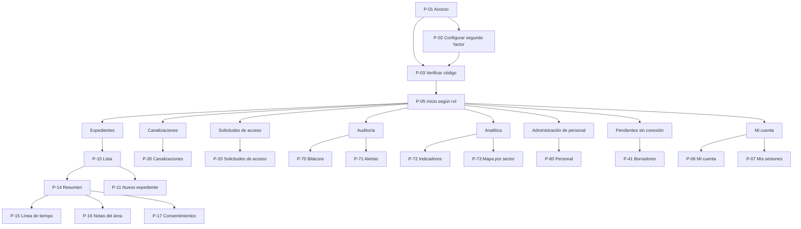
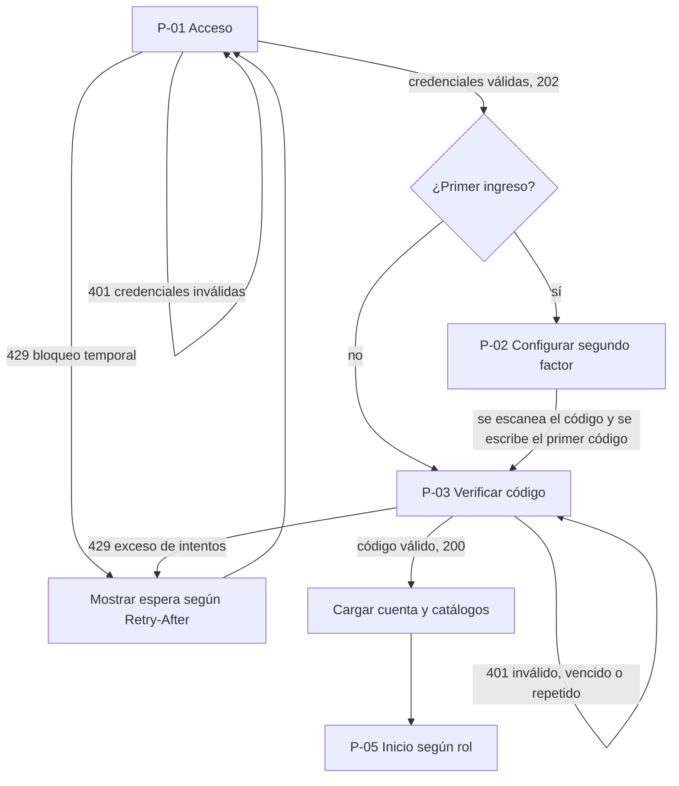
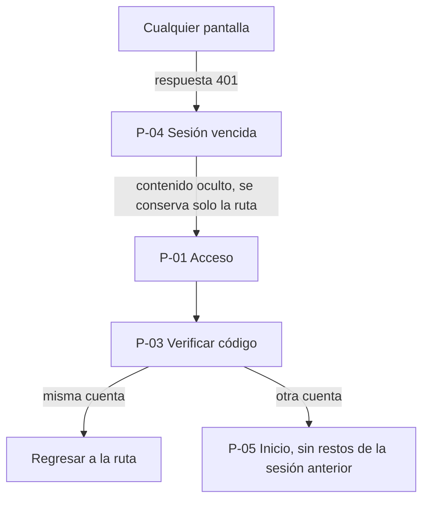
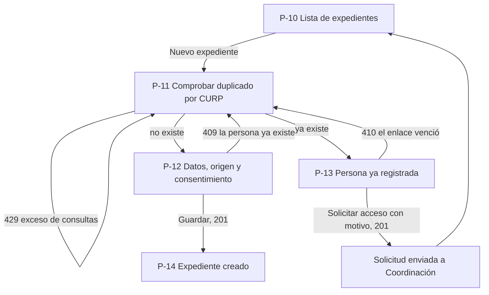
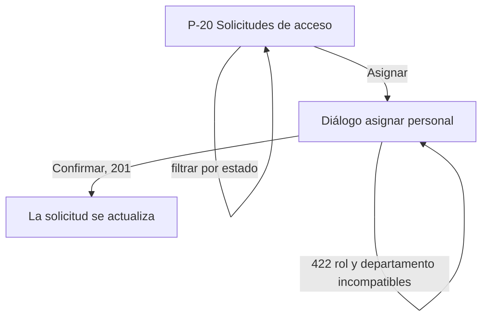
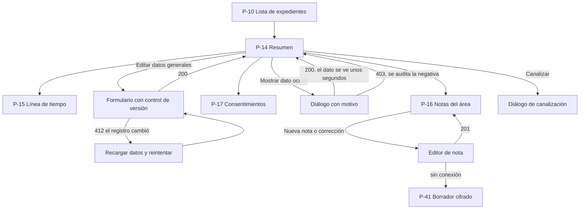
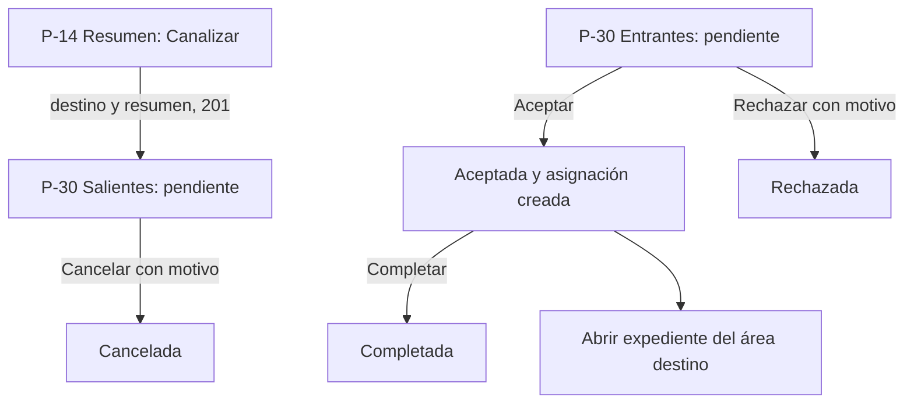
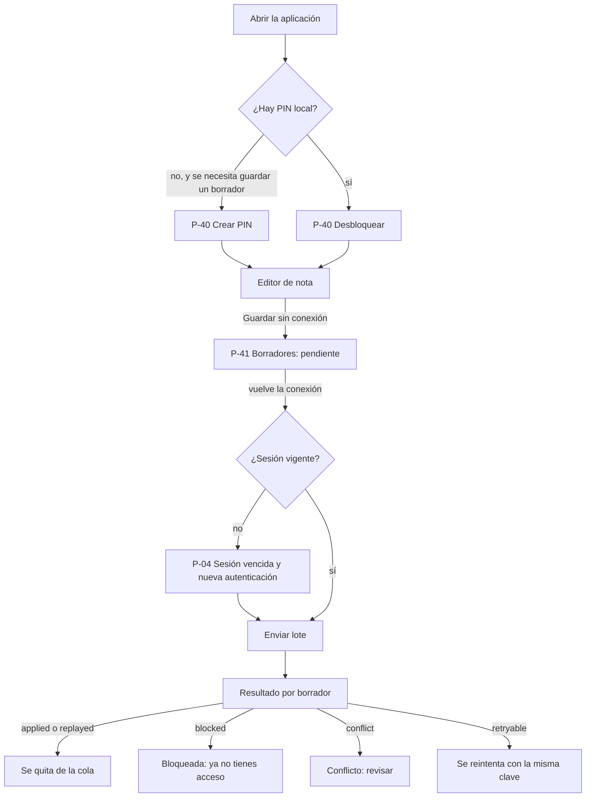
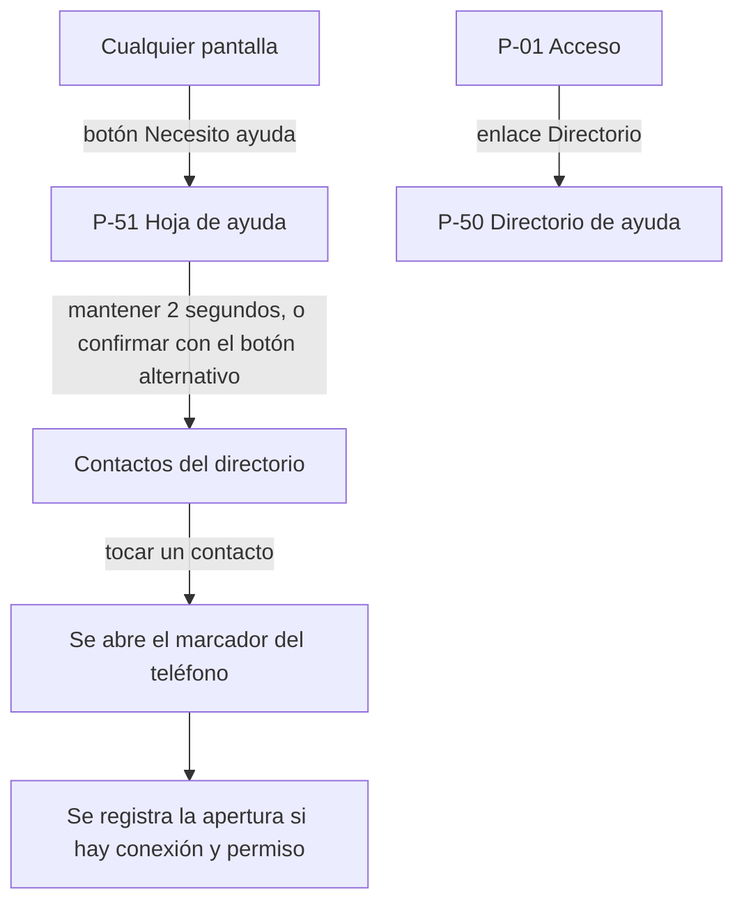
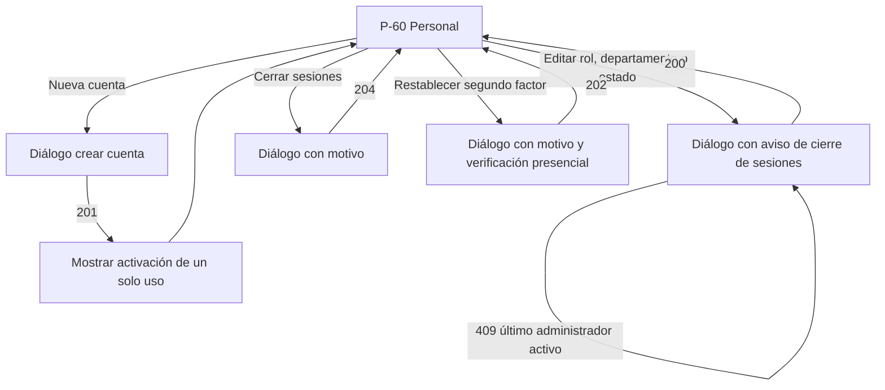

# SAI — Flujo de pantallas del MVP

**Versión:** 0.1 — diseño del flujo del frontend
**Base:** `01_SRS_A_MVP` (RF-01 a RF-14, RNF y reglas de negocio) y `ENDPOINTS_SAI_MVP` v1.1 (41 operaciones)
**Alcance:** únicamente el personal de la Secretaría. El MVP no incluye portal de usuarias, citas, tareas, adjuntos, cursos, empleo ni encuestas, así que no hay pantallas para ellos.
**Archivo complementario:** `PANTALLAS_ENDPOINTS_SAI_MVP.md` (qué endpoint llama cada pantalla, headers, formularios y validaciones).

Este documento registra **cómo se mueve una persona por la aplicación**. Los nombres de pantalla (`P-xx`) y las rutas del cliente son propuestas del frontend; las rutas de la API son las del documento de endpoints y no se modifican aquí.

---

## 1. Principios que gobiernan el flujo

Salen del SRS y condicionan cada pantalla:

1. **Ocultar no es autorizar.** El menú y los botones se derivan del rol y los permisos del actor (`GET /users/me`), pero quien decide es el servidor en cada petición (RNF-01).
2. **No hay copia local de expedientes.** Sin conexión solo se pueden usar el directorio de ayuda y los borradores de notas cifrados. Nada de datos de negocio en caché ni en `localStorage` (RF-11, RF-12, RNF-07).
3. **Un solo "no disponible".** Un expediente ajeno y uno inexistente llevan a la misma pantalla y el mismo texto; la interfaz nunca los distingue (AT-02).
4. **Lo que no te corresponde no se anuncia.** Las secciones de otras áreas no se muestran con conteos ni candados que confirmen que hay notas (SRS §10).
5. **La sesión vence.** Por inactividad (15 min) o por duración máxima (8 h). Al vencer, el contenido se oculta y se pide autenticarse; nunca se sigue autorizando con datos locales (RNF-04).
6. **Lo sensible tiene costo.** Revelar un dato oculto exige motivo y queda auditado; consultar la bitácora también queda auditado, y la pantalla lo avisa.
7. **Reintentar no duplica.** Todo formulario que crea algo genera su `Idempotency-Key` al abrirse y la conserva en cada reintento.
8. **La ayuda no promete.** El botón abre el marcador del teléfono; la interfaz nunca dice que la llamada se completó ni que alguien acudirá (RF-12).
9. **Salida rápida siempre visible**, incluso en la pantalla de acceso. Lleva a una página neutra y no promete borrar rastros del dispositivo.
10. **Textos neutros.** La aplicación se instala como "Agenda"; títulos, íconos y notificaciones no deben delatar su propósito.
11. **Adaptable desde 360 px**, controles táctiles de 48 px, foco visible y estados que no dependan solo del color (RNF-08).

---

## 2. Mapa de navegación

Presentes en **todas** las pantallas autenticadas: botón **Necesito ayuda** (P-51), botón **Salir** (salida rápida) y aviso de estado de conexión. En la pantalla de acceso solo están la salida rápida y el enlace al directorio de ayuda (P-50), que es público.

### Menú por rol

El menú se construye con el rol; si algo requiere un permiso adicional (bitácora, bandeja de canalizaciones, ayuda), se muestra solo cuando el actor lo trae.

| Rol | Opciones de menú |
|---|---|
| **TrabajoSocial** | Inicio · Expedientes · Nuevo expediente · Canalizaciones · Pendientes · Ayuda · Mi cuenta |
| **Psicología** | Inicio · Expedientes (asignados) · Canalizaciones* · Pendientes · Ayuda · Mi cuenta |
| **Jurídico** | Inicio · Expedientes (asignados) · Canalizaciones* · Pendientes · Ayuda · Mi cuenta |
| **Coordinación** | Inicio · Solicitudes de acceso · Canalizaciones* · Auditoría* · Analítica · Ayuda · Mi cuenta |
| **Dirección** | Inicio · Auditoría* · Analítica · Ayuda · Mi cuenta |
| **AdministradorTI** | Inicio · Administración de personal · Ayuda · Mi cuenta |
| **AdministraciónAnalítica** | Inicio · Analítica · Ayuda · Mi cuenta |

\* Requiere el permiso correspondiente además del rol.

Coordinación, Dirección, AdministradorTI y AdministraciónAnalítica **no tienen la opción Expedientes**: la jerarquía no concede lectura de expedientes ni de notas.

---

## 3. Inventario de pantallas

| ID | Pantalla | Ruta del cliente | Quién la usa |
|---|---|---|---|
| P-01 | Acceso (usuario y contraseña) | `/acceso` | Anónimo |
| P-02 | Configurar segundo factor (primer ingreso) | `/acceso/configurar-mfa` | Preautenticado |
| P-03 | Verificar código | `/acceso/verificacion` | Preautenticado |
| P-04 | Sesión vencida (contenido oculto) | `/sesion-vencida` | Cualquier rol |
| P-05 | Inicio | `/` | Cualquier rol |
| P-06 | Mi cuenta | `/cuenta` | Cualquier rol |
| P-07 | Mis sesiones | `/cuenta/sesiones` | Cualquier rol |
| P-10 | Lista de expedientes | `/expedientes` | TrabajoSocial, Psicología, Jurídico |
| P-11 | Nuevo expediente: comprobar duplicado | `/expedientes/nuevo` | TrabajoSocial |
| P-12 | Nuevo expediente: datos, origen y consentimiento | `/expedientes/nuevo/datos` | TrabajoSocial |
| P-13 | Persona ya registrada: solicitar acceso | `/expedientes/nuevo/existente` | TrabajoSocial |
| P-14 | Expediente: resumen | `/expedientes/:recordId` | Asignados |
| P-15 | Expediente: línea de tiempo | `/expedientes/:recordId/linea-de-tiempo` | Asignados |
| P-16 | Expediente: notas de un área | `/expedientes/:recordId/areas/:departmentId/notas` | Asignados al caso y al área |
| P-17 | Expediente: consentimientos | `/expedientes/:recordId/consentimientos` | Asignados |
| P-20 | Solicitudes de acceso | `/solicitudes-acceso` | Coordinación |
| P-30 | Canalizaciones (entrantes y salientes) | `/canalizaciones` | Origen asignado o receptor con permiso |
| P-40 | Crear o desbloquear PIN local | `/pin` | Personal con borradores |
| P-41 | Borradores pendientes | `/pendientes` | TrabajoSocial, Psicología, Jurídico |
| P-50 | Directorio de ayuda | `/ayuda` | Público (sin sesión) |
| P-51 | Hoja "Necesito ayuda" | Superposición global | Personal autenticado |
| P-60 | Administración de personal | `/administracion/personal` | AdministradorTI |
| P-70 | Bitácora | `/auditoria` | Dirección, Coordinación |
| P-71 | Alertas de acceso | `/auditoria/alertas` | Dirección, Coordinación |
| P-72 | Indicadores | `/analitica` | AdministraciónAnalítica, Dirección, Coordinación |
| P-73 | Mapa por sector | `/analitica/mapa` | AdministraciónAnalítica, Dirección, Coordinación |
| P-90 | Recurso no disponible | `*` | Cualquiera |
| P-91 | Sin conexión | Estado global | Cualquiera |

Diálogos (no tienen ruta propia): editar datos generales, revelar dato oculto, nueva nota o corrección, registrar consentimiento, revocar consentimiento, canalizar, asignar personal, crear o editar cuenta, motivos de acciones.

---

## 4. Flujos

### 4.1 Acceso y sesión (RF-01, RF-02)

**Objetivo:** iniciar una sesión completa solo después de contraseña **y** segundo factor.

Pasos:

1. P-01 obtiene el token CSRF al abrirse y envía usuario y contraseña. La respuesta indica si sigue configurar o verificar el segundo factor.
2. **P-02** (solo primer ingreso): muestra el código para la app autenticadora **una sola vez** y pide el primer código de 6 dígitos.
3. **P-03**: pide el código de 6 dígitos. Un código ya usado se rechaza.
4. Al completar, se renueva el token CSRF, se consulta la cuenta y se cargan los catálogos. Desde aquí el menú depende del rol.
5. Una contraseña correcta sin segundo factor nunca da acceso a una pantalla de negocio (AT-01): si alguien escribe la ruta de un expediente con la sesión parcial, vuelve a P-01.

**Sesión vencida:**

- Al recibir 401, el contenido de la pantalla se oculta de inmediato.
- Si vuelve a entrar **la misma cuenta**, regresa a la ruta donde estaba. Si entra **otra**, se descarta todo.
- Cerrar sesión desde el menú: si hay borradores pendientes, avisa que se eliminarán al salir, **sin impedir la salida inmediata** (SRS §5, regla 11). Después limpia datos locales y vuelve a P-01.

### 4.2 Alta o vinculación de un expediente (RF-03, RF-04)

**Quién:** TrabajoSocial. **Objetivo:** crear el expediente sin duplicar a la persona.

Pasos:

1. **P-11:** una sola entrada, la CURP. Se normaliza (mayúsculas, sin espacios) y se valida el formato antes de enviarla. La CURP **nunca va en la URL**, solo en el cuerpo de la consulta, y no se conserva al salir de la pantalla.
2. **Resultado "no existe":** pasa a P-12 con la CURP ya capturada, en memoria.
3. **P-12** reúne en un solo formulario lo que la API crea en una transacción: datos de la persona, origen del contacto y consentimiento. Si algo falla, no queda un alta parcial.
4. **Resultado "ya existe":** P-13 muestra únicamente que existe y qué departamento lo lleva. **No muestra nombre, notas ni identificador.** Permite pedir acceso con un motivo; el enlace de la consulta dura poco y, si vence, hay que repetir la consulta.
5. **Conflicto 409 al guardar:** otra persona dio de alta a la misma CURP en ese momento. Se vuelve a P-11 y el resultado de la nueva consulta lleva a P-13. No se muestra información del otro expediente.
6. **Sin CURP:** no hay formulario de alta. P-11 muestra un aviso: la atención urgente no depende del alta y el procedimiento de solicitud asistida se gestiona fuera de esta pantalla (ver límites en §6). Se ofrece el acceso al directorio de ayuda.
7. **Consentimiento en P-12:** la persona puede registrar "aceptado" o "rechazado". Un rechazo no se transforma en consentimiento. Si el aviso vigente cambia mientras se llena el formulario, el servidor responde conflicto y se pide revisar la versión.

### 4.3 Resolver solicitudes de acceso (RF-03, RF-06)

**Quién:** Coordinación. **Objetivo:** dar acceso a quien lo pidió, sin leer el expediente.

- La lista muestra solo **metadatos**: solicitante, departamento, motivo y estado. Nunca datos de identidad ni notas.
- El diálogo exige el motivo (10 a 500 caracteres) y lleva el identificador de la solicitud que se está resolviendo.
- Asignar no abre el expediente para Coordinación; solo le da acceso a la persona asignada.
- Esta pantalla **no tiene botón "Rechazar"**: el contrato no define esa operación (ver §6).

### 4.4 Atención de un caso (RF-05, RF-07, RF-08, RF-14)

**Quién:** TrabajoSocial, Psicología y Jurídico, solo sobre casos asignados.

**P-10 Lista.** Muestra los expedientes asignados con alias neutro, estado, área y fechas. Filtros: estado, rango de fechas y departamento. **No hay buscador por nombre o CURP**, porque la API no lo ofrece a propósito. Paginada, con 20 por página.

**P-14 Resumen.** Datos generales permitidos. El domicilio, la CURP y el teléfono aparecen enmascarados y, junto a cada uno, un botón **Mostrar**:
- Pide un motivo (10 a 500 caracteres).
- Si el servidor lo concede, muestra el valor unos segundos y vuelve a ocultarlo. No se guarda en el estado de la aplicación.
- Si lo deniega, avisa sin dar detalles. La denegación queda en bitácora.

La edición de datos generales (solo TrabajoSocial asignado) carga el registro con su versión. Si la versión es antigua (412) se recargan los datos y la persona decide si reaplica su cambio. Cambiar el estado sigue la secuencia `abierto → en_seguimiento → cerrado`; **reabrir un cerrado exige motivo**.

**P-15 Línea de tiempo.** Solo eventos de las áreas del actor. Sin conteos de secciones prohibidas.

**P-16 Notas del área.**
- El selector de área ofrece solo las áreas autorizadas para el actor. Las demás no aparecen ni se sugiere que existan.
- Las notas son inmutables: **corregir** crea una nota nueva que referencia a la anterior, y la pantalla muestra ambas encadenadas. No hay botones de editar ni borrar.
- El texto va de 1 a 10 000 caracteres. La hora que se envía es la del dispositivo y se presenta como "hora declarada"; la hora de registro la pone el servidor.
- Si no hay conexión, el editor ofrece guardar un borrador cifrado (ver 4.6).

**P-17 Consentimientos.** TrabajoSocial ve el historial completo y puede registrar uno nuevo o revocar finalidades opcionales. Los profesionales ven solo las vigencias que necesitan. La revocación no borra la decisión original: el historial sigue visible.

### 4.5 Canalización interna (RF-09)

- **Crear:** el profesional asignado elige el departamento destino y escribe un resumen de hasta 2 000 caracteres. El destino no puede ser su propio departamento y no puede haber otra canalización activa equivalente.
- **P-30** tiene dos pestañas, **Entrantes** y **Salientes**, y un filtro de estado. Cada elemento muestra un resumen mínimo, nunca notas de otras áreas.
- **Acciones según estado y quién:**
  - Entrante pendiente: Aceptar o Rechazar (el rechazo exige motivo de 10 a 500).
  - Entrante aceptada: Completar.
  - Saliente pendiente: Cancelar (exige motivo).
- Cada acción lleva la versión del elemento tal como vino del listado. Si cambió, se recarga la lista.
- **Aceptar** crea al mismo tiempo la asignación del área destino. Solo después de aceptar aparece el enlace **Abrir expediente**; antes el receptor no puede abrir nada.

### 4.6 Notas sin conexión (RF-11)

- **Solo se guardan borradores de notas propias.** Nada de expedientes completos.
- El PIN local cifra la cola; no es la contraseña ni el segundo factor. Se crea la primera vez que hace falta y se pide al abrir la aplicación si hay borradores.
- Al volver la conexión se envían hasta 20 borradores por lote. Cada borrador se resuelve por separado y **solo se elimina el que el servidor confirma**.
- **Bloqueada** significa que se retiró la asignación antes de sincronizar. La nota no se incorpora, el autor no cambia y la interfaz lo explica. La persona decide si descarta el borrador.
- Si la sesión venció, primero se vuelve a autenticar y luego se envía con las mismas claves.
- Cerrar sesión elimina la cola y las claves locales.

**P-41 Borradores** muestra por cada uno: expediente (alias), área, hora declarada y estado (pendiente, enviando, bloqueada, conflicto, reintentable). Acciones: reintentar y descartar.

### 4.7 Ayuda y directorio (RF-12)

- El botón **Necesito ayuda** está en todas las pantallas autenticadas. Se activa **manteniendo presionado 2 segundos** o, para quien no pueda hacerlo, con una confirmación accesible por teclado y lector de pantalla.
- La hoja lista los contactos prioritarios del directorio institucional con un enlace de llamada por cada uno. No se supone un número por defecto.
- El texto de la hoja aclara que la aplicación **abre el marcador** y no confirma la llamada ni la atención.
- **Sin conexión** funciona igual, con la copia del directorio guardada en el dispositivo.
- Registrar la apertura es opcional y posterior: solo si hay conexión y el actor tiene el permiso de ayuda. Si no se puede registrar, no se guarda en el dispositivo (la cola local admite solo notas) y no se avisa como error.
- **P-50** es pública y no necesita sesión. La primera vez que hay conexión guarda una copia versionada del directorio para uso sin conexión.

### 4.8 Administración del personal (RF-02)

**Quién:** AdministradorTI.

- La lista muestra solo identidad laboral: usuario, nombre laboral, rol, departamento y estado. Con búsqueda por texto y paginación. **Nunca** datos de personas atendidas.
- **Crear cuenta:** usuario, nombre laboral, rol y departamento. La respuesta trae los datos de activación de un solo uso, que se muestran **una única vez** con la indicación de entregarlos de forma presencial.
- **Editar:** cambiar rol, departamento o suspender cierra todas las sesiones de esa cuenta, y el diálogo lo advierte antes de confirmar. La fila de la propia cuenta del administrador no ofrece editar rol ni estado.
- **Restablecer segundo factor:** pide motivo y marcar que la verificación presencial se hizo. Al responder, la pantalla dice que el restablecimiento quedó **solicitado** y que la persona deberá volver a configurar su segundo factor; no afirma que el proceso terminó.

### 4.9 Auditoría e indicadores (RF-10, RF-13)

**Bitácora (P-70)**
- Lista de eventos con filtros: actor, expediente, acción y rango de fechas. No hay búsqueda por CURP.
- Un aviso fijo recuerda que **esta consulta también queda registrada**.
- Solo lectura: no hay ninguna acción de editar o borrar.

**Alertas (P-71)**
- Lista de alertas por volumen de consultas, con filtro de estado: actor, ventana, umbral y nivel.

**Indicadores (P-72)**
- Filtros: periodo, sector, tipo y estatus. Los periodos son discretos.
- Cada indicador muestra su corte, su metodología y su denominador.
- Los valores **suprimidos** se muestran con un guion y una leyenda de privacidad ("menos de 5 casos"). Los totales que permitirían deducir una celda suprimida aparecen como no disponibles.

**Mapa (P-73)**
- Sectores con escala violeta de 1 a 5, leyenda, periodo y corte. Los sectores suprimidos se muestran con un patrón distinto y no por color solamente.
- Nunca puntos individuales ni coordenadas.

---

## 5. Estados transversales de pantalla

Estados que toda pantalla con datos debe resolver:

| Estado | Qué muestra la pantalla |
|---|---|
| Cargando | Esqueleto o indicador, sin contenido anterior de otra cuenta |
| Vacío | Texto neutro sin sugerir que hay información oculta (por ejemplo "No tienes expedientes asignados") |
| Sin conexión (P-91) | Aviso global. Las pantallas de datos de negocio indican que no están disponibles sin conexión y ofrecen ir a Pendientes o al directorio |
| Error | Mensaje genérico con el `requestId` para soporte, nunca detalles técnicos |

Respuestas de la API y su tratamiento en la interfaz:

| Respuesta | Tratamiento |
|---|---|
| 401 | Ocultar el contenido y llevar a P-04 |
| 403 | "No tienes permiso para esta acción." Sin explicar la causa. Si el permiso falta globalmente, se oculta esa opción en adelante |
| 404 | P-90 con el texto único "Recurso no disponible." Igual para ajeno e inexistente |
| 409 | Depende de la operación: duplicado, transición inválida, conflicto de clave o reintento vencido. Cada pantalla define su mensaje (ver `PANTALLAS_ENDPOINTS_SAI_MVP.md`) |
| 410 | Enlace temporal vencido: volver al paso anterior |
| 412 | El registro cambió: recargar y permitir reintentar |
| 422 | Marcar el campo con error. Si es un cursor o un filtro inválido, reiniciar la lista |
| 428 | Error de programación del cliente (falta la versión): no debe llegar a la persona |
| 429 | Deshabilitar la acción y mostrar la espera indicada por `Retry-After` |
| 500 / 503 | Mensaje genérico con `requestId`; sin reintentos automáticos en operaciones que escriben |

---

## 6. Límites del contrato que afectan a las pantallas

Estos puntos no están resueltos en el documento de endpoints. **No se deben inventar rutas** para resolverlos en el frontend: hay que cerrarlos en el contrato OpenAPI antes de construir la pantalla afectada.

| # | Situación | Efecto en pantallas |
|---|---|---|
| 1 | Coordinación necesita elegir a quién asignar, pero `GET /users` es solo de AdministradorTI y los catálogos no incluyen personal | El diálogo de asignar de P-20 no puede ofrecer selector de personal hasta definir de dónde sale la lista |
| 2 | Aceptar una canalización admite `assignedStaffId` opcional, con la misma falta de lista de personal | P-30 no ofrece selector; envía la aceptación sin ese campo |
| 3 | No hay endpoint que liste asignaciones ni forma de obtener `assignmentId` | La revocación de asignaciones no tiene pantalla asignable hasta definir cómo obtener ese identificador |
| 4 | No existe operación para rechazar una solicitud de acceso | P-20 sin botón de rechazo |
| 5 | No hay `GET` individual de nota, canalización ni cuenta | El detalle se arma con los datos de los listados, incluidos `versionTag` y el ETag |
| 6 | No hay ruta de activación de primer acceso ni de **cambio de contraseña** | Sin pantalla "Primer acceso" ni "Cambiar contraseña". El primer ingreso usa el flujo normal con la contraseña temporal entregada de forma presencial |
| 7 | La solicitud asistida sin CURP (SRS §5, regla 2) no tiene endpoint | P-11 solo informa y deriva al directorio |
| 8 | `GET /catalogs` debe devolver también sectores y propósitos de consentimiento (los DTO los piden como claves de catálogo), y no está listado | P-12 y P-17 no pueden poblar esos campos hasta confirmarlo |
| 9 | No están definidas las claves de `Actor.permissions` (bitácora, bandeja, ayuda) | El menú por permiso se implementa cuando OpenAPI las nombre |
| 10 | El formato de la geometría de sectores del mapa no está definido | P-73 no puede dibujar el mapa hasta cerrar ese formato |
| 11 | La respuesta de activación de cuenta (DTO) de la creación de usuarios está por cerrar | El diálogo posterior a crear cuenta se termina de diseñar con ese DTO |

---

## 7. Orden sugerido para construir las pantallas

Alineado con los cuatro días del SRS (sección 12):

| Día | Pantallas | Resultado |
|---|---|---|
| 1 | Estructura general (menú por rol, salida rápida, aviso de conexión), P-01, P-02, P-03, P-04, P-05, P-90 | Sesión completa separada de la preautenticación |
| 2 | P-10, P-11, P-12, P-13, P-14, P-20 | Alta atómica, duplicados, lista y resumen del expediente |
| 3 | P-15, P-16, P-17, P-30, P-40, P-41, P-50, P-51, P-70, P-72 | Notas, canalización, offline, ayuda, bitácora e indicadores mínimos |
| 4 | P-60, P-06, P-07, P-71, P-73, ajustes de accesibilidad y ensayo en teléfono | Pantallas de apoyo, pruebas y congelamiento del alcance |

Si el tiempo no alcanza, el orden de recorte es: P-73, P-71, P-60 (se usan cuentas sembradas), P-07. El recorrido de demostración exige: P-01 a P-03, P-11 a P-14, P-16, P-30, P-41, P-70 y P-72.
